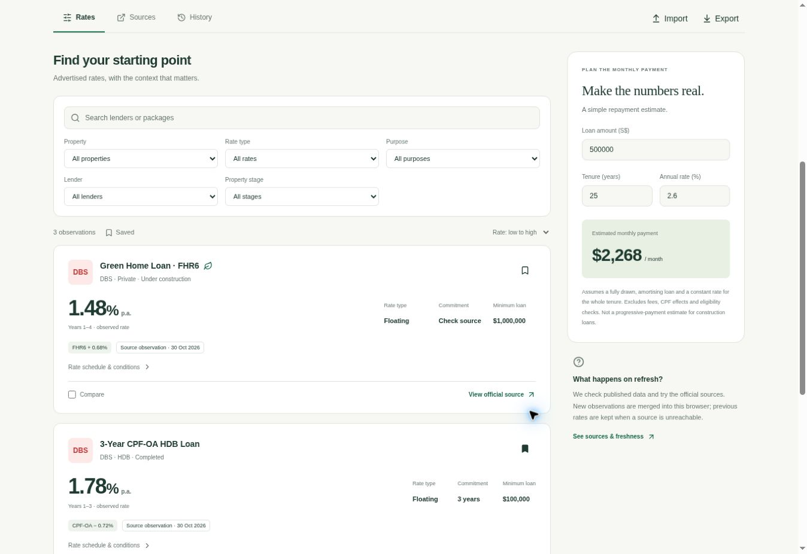

> Historical validation of the source application before its RatePro migration.
> This is not evidence of a RatePro Cloudflare deployment. See
> [RATEPRO_MIGRATION.md](RATEPRO_MIGRATION.md) for the new repository status.

# Original React migration validation — 30 October 2026

## Automated

- 27 Vitest tests: source parsers, malformed/blocked sources, all-in rate versus spread extraction, incremental merge, deduplication, older/future observation handling, rate/term history, bounded storage, quota/corruption, safe imports, six-hour throttling, partial/total network failures, progressive snapshot rendering, response-size limits and amortisation arithmetic.
- TypeScript strict check and Vite production build passed.
- Prettier check passed for the final source tree.
- Static output contains the real `/data/rates.json`, security headers and bundled assets; no Django or runtime API is required.

## Live collection

`npm run collect` successfully retrieved and parsed the DBS HDB CPF-OA and DBS Green FHR6 package tables. HDB returned HTTP 403; the initial reviewed quarterly snapshot remained unchanged and its failure status was recorded. Direct HTML and search-indexed DBS content differed; only direct table observations were used for DBS.

## Browser interaction

Checked in the provided Chrome preview:

- Three source-labelled observations render from the same-origin static feed while direct page reads remain unavailable.
- HDB filter reduces the result to two observations; the Fixed filter produces the honest empty state.
- Saving the CPF-OA package survives a reload; dark mode also survives a reload.
- Two-package comparison opens a Radix dialog with correct terms and monthly estimates (S$500,000, 25 years: approximately S$2,268 at 2.6%, S$2,066 at 1.78%).
- Layout visually checked at desktop width and in a 390px-wide iframe, in light/dark themes. The temporary mobile harness is excluded from the repository and production build.

## Not verified

- No live Cloudflare account deployment or custom domain was performed. Build output and deployment configuration are ready for Cloudflare Pages.
- The scheduled collector requires merge to the default branch, enabled Actions and permission to commit snapshots. Its daily trigger and subsequent Cloudflare Git integration deployment are not yet exercised.
- HDB live extraction could not be verified because the source returned HTTP 403. Unit fixtures cover the parser structure, not live accessibility.
- This is a limited source directory, not a whole-market mortgage search. Browser caching preserves data, not a guaranteed offline app-shell installation.
